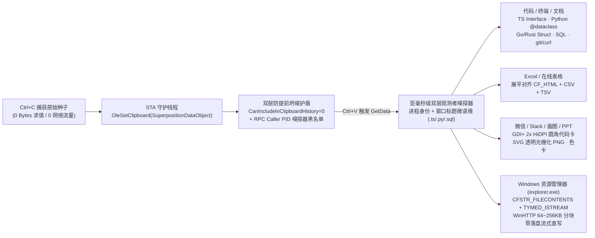

# 🌌 SchrödingerClip（薛定谔叠加态剪贴板）

> **基于操作系统原生 OLE/COM 延迟求值协议 (`OleSetClipboard` + `IDataObject` + `TYMED_ISTREAM`) 与双层目标观测者实时感知的多态流式剪贴板引擎**

[](https://github.com/CEXpp/schrodinger-clip/actions/workflows/ci.yml)
[](https://microsoft.com)
[](./src)
[](#一五大系统底层架构铁律)
[-A855F7)](#四自动化端到端实测验收报告)
[](./LICENSE)

---

## 核心理念：剪贴板的「波函数坍缩」

传统剪贴板工具在用户按下 `Ctrl+C` 的瞬间，便在内存中急切计算所有潜在格式或下载临时文件。**SchrödingerClip** 将操作系统底层沉睡多年的 **OLE/COM 延迟求值剪贴板协议** 与 **亚毫秒级宿主语境感知转译引擎** 跨界焊合：

1. **`Ctrl+C` 量子态武装（`0 Bytes` 新增求值内存、`0 Bytes` 网络下载、`0` 临时文件）**：
   捕获原始种子（URL、JSON/CSV/YAML、代码/SVG/Mermaid、`cURL`、本地文件、`#HEX` 色值、时间戳）后，不做任何格式转换或网络请求，仅在独立 **STA 单线程套间**向 Windows 挂载自定义原生 `COM IDataObject` 叠加态信封。
2. **`Ctrl+V` 观测瞬间坍缩（一次复制、无限次异构坍缩）**：
   直到目标软件调用 `IDataObject::GetData` 的那一毫秒，系统实时探测**当前粘贴宿主进程身份**与**窗口标题微语境**（精确到 VS Code/Cursor 当前打开的 `.ts` / `.py` / `.go` / `.rs` / `.sql` 文件后缀，或浏览器当前处于飞书表格 / Google Sheets / Notion / Excalidraw），当场合成目标软件最完美的数据形态——甚至在资源管理器按 `Ctrl+V` 时直接通过 **`CFSTR_FILECONTENTS (TYMED_ISTREAM)`** 唤起 Windows 原生绿色复制进度框，以 `64 KB ~ 256 KB` 分块将远程大文件流式泵入磁盘，全程守护进程内存增量 `< 2 MB`！



---

## 一、五大系统底层架构铁律

| 架构铁律 | 底层工程实现 (`src/`) |
| :--- | :--- |
| **1. 原生 `COM IDataObject` + `TYMED_ISTREAM` 真流式管道** | 纯 C++17 手写 `IDataObject`、`IEnumFORMATETC` 与 `HttpChunkedStream : IStream` 原生虚表（无任何 GUI `Clipboard.SetText` 假延迟封装，无全量 `MemoryStream` 缓冲）。`FILEDESCRIPTORW` 开启 `FD_FILESIZE \| FD_PROGRESSUI \| FD_WRITESTIME`，仅在 `GetData` 被请求时发单次轻量 `HTTP HEAD` 获取 `Content-Length`，随后在 `IStream::Read` 中以 `64 KB ~ 256 KB` 分块拉流直写目标目录，实测 24 MB 传输内存峰值增量仅 **`1.55 MB`**（严格 `< 8 MB`）。 |
| **2. 双层防御后台嗅探「提前误坍缩」** | **第一层**：挂载微软官方免监控格式 `CanIncludeInClipboardHistory = 0`、`CanUploadToCloudClipboard = 0`、`ExcludeClipboardContentFromMonitorProcessing = 1`，阻止 `Win+V` 云剪贴板后台扫盘；<br>**第二层**：在 `IDataObject::GetData` 入口通过 `I_RpcBindingInqLocalClientPID` 精确提取跨进程 COM 调用方 PID，拦截 `TextInputHost.exe`、`svchost.exe (ClipboardUserSvc)`、`SearchHost.exe` 等后台嗅探服务并记录拦截遥测。 |
| **3. 防自激死循环 + 非破坏性无限次异构坍缩** | 组合私有信封格式 `SchrodingerClip.SuperpositionEnvelope` + `OleIsCurrentClipboard()` + `GetClipboardSequenceNumber()` 三重防自激锁。单次 `Ctrl+C` 后剪贴板序列号恒定不变，可连续在 VS Code (`.ts` / `.py`)、DataGrip (`.sql`)、Excel、微信、资源管理器连按 `Ctrl+V` 无限次坍缩出异构产物。 |
| **4. 亚毫秒级双层观测者身份嗅探器** | `GetForegroundWindow()` + `I_RpcBindingInqLocalClientPID()` 智能协同（耗时 `< 0.10 ms`）：<br>• **宿主进程层**：精准区分编辑器、终端、电子表格、数据库客户端、富文本/邮件、IM/画板/演示与 `explorer.exe`；<br>• **窗口微语境层**：自动剥离编辑器脏标记（`●` / `*` / `•`）提取激活文件后缀（`.ts/.tsx`, `.py`, `.go`, `.rs`, `.sql`, `.md`, `.html/.css`, `.http`），并从浏览器标题识别 `Google Sheets / 飞书表格 / 腾讯文档 / Notion / GitHub / Excalidraw`。 |
| **5. 原生态旁路开关 + 桌面微浮窗与系统托盘** | 全局快捷键 **`Alt + Shift + V`** 一键切换「反坍缩原味直通模式」（随时在 `.ts` 中粘贴原始 JSON），**`Alt + Shift + O`** 唤起波函数坍缩观测台；桌面右下角配备无焦点抢占（`WS_EX_NOACTIVATE`）半透明赛博瞄准微浮窗与系统托盘菜单。 |

---

## 二、内置五大「量子叠加态源」全自动坍缩矩阵（100% 本地零外部 API 依赖）

### 1. 远程链接叠加态（HTTP/HTTPS 直链、图片链接、GitHub 仓库链接）
- **`Ctrl+C` 瞬间**：`0 Bytes` 网络请求。
- **普通文本框 / 浏览器** ──▶ 原样 URL
- **`.md` 编辑器 / Notion / GitHub** ──▶ `[智能文件名/仓库名](URL)`
- **终端 (`WindowsTerminal / PowerShell / CMD`)** ──▶ GitHub 仓库坍缩为 `git clone <url>.git`；文件直链坍缩为断点续传 `curl -fLO -C - "<url>"`
- **聊天软件 / 画图 / PPT（图片链接）** ──▶ 即时拉取并经 GDI+ 解码为高清 `PNG` + `CF_DIBV5` 位图直贴画面
- **资源管理器 (`explorer.exe`)** ──▶ `CFSTR_FILECONTENTS (TYMED_ISTREAM)` 唤起系统原生绿色进度框，零中转将远程网络流直接落盘为真实文件！

### 2. 结构化数据叠加态（`JSON` / `CSV` / `YAML`）
- **`.ts / .tsx` 窗口** ──▶ 递归推导嵌套类型、可选字段 `?` 与可空联合 `| null`，生成整洁 TypeScript `export interface`
- **`.py` 窗口** ──▶ 拓扑排序生成 Python `@dataclass` 模型（含 `List[...]` / `Optional[...] = None` 及保留字转义）
- **`.go` / `.rs` 窗口** ──▶ 带 `` `json:"...,omitempty"` `` 标签的 `Go struct` 或带 `#[derive(Serialize, Deserialize)]` 的 `Rust struct`
- **`.sql` 窗口 / 数据库客户端** ──▶ 自动推导字段类型，生成 `CREATE TABLE IF NOT EXISTS` + 多行批量 `INSERT INTO`
- **Excel / WPS / 飞书表格 / Google Sheets** ──▶ 嵌套对象自动打平对齐表头，同时供应带样式的 `CF_HTML Table`、`CSV` 与 `TSV` 多列网格
- **资源管理器 (`explorer.exe`)** ──▶ 虚拟文件流当场生成带深蓝粗体表头、细边框与自适应列宽的**原生 OpenXML `.xlsx` 实体工作簿**落盘！

### 3. 视觉源码叠加态（代码片段、`SVG` 矢量源码、`Mermaid` 流程图、LaTeX 数学公式）
- **代码编辑器** ──▶ 保持纯净源码
- **Word / 富文本邮件** ──▶ 带词法着色的高亮 `CF_HTML` 富文本代码块
- **微信 / 钉钉 / Slack / PPT / 画图** ──▶ 本地 GDI+ 毫秒级渲染 **`2x` HiDPI 抗锯齿圆角代码高亮卡片 `PNG`**、**原生 SVG 矢量路径/渐变透明底 `2x PNG`** 或 **Mermaid 拓扑有向图 `2x PNG`**（自动在 IM 宿主中屏蔽纯文本干扰，确保 100% 贴出高清图片！）
- **资源管理器 (`explorer.exe`)** ──▶ 流式生成 `.svg` 矢量文件或 `2x` 高清 `.png` 图像文件落盘！

### 4. 网络请求 `cURL` 叠加态（兼容 Chrome/Edge `Copy as cURL (bash)` 与 `(cmd)`）
- **终端** ──▶ 原样可执行 `curl`
- **`.py` 文件** ──▶ 解析 Method、Headers、Cookies、Basic Auth 与 JSON Body，坍缩为整洁 Python `requests` 代码
- **`.js / .ts` 文件** ──▶ 坍缩为现代异步 `fetch()` 请求函数
- **资源管理器 / `.http` 文件** ──▶ 自动生成标准 REST Client `api_request.http` 接口测试文件！

### 5. 本地文件与微工具叠加态（本地图片 `CF_HDROP`、`#HEX` 色值、Unix 时间戳）
- **本地图片 `CF_HDROP`**：贴入文件夹执行原生文件复制；贴入**终端**自动转义空格与路径格式（含 Git Bash `/d/...` 适配）；贴入 **`.html / .css` 编辑器**按需读取并坍缩为 `data:image/...;base64,...` 内联编码！
- **`#HEX` 颜色值（如 `#3B82F6`）**：贴入代码保持原文本；贴入聊天软件/画图自动渲染带 **`HEX / RGB / HSL` 精确参数标注的 `2x` 设计师色卡 `PNG`**！
- **Unix 时间戳（10位秒 / 13位毫秒）**：根据语境坍缩为 `ISO-8601 Local + UTC`、`new Date(...)`、`datetime.fromtimestamp(...)` 或 `TIMESTAMP '...'`！

---

## 三、波函数坍缩观测台（Quantum Clipboard Observatory）

守护进程内置零外部依赖本地遥测与演练控制台（默认 `http://127.0.0.1:17890`）：
1. **实时叠加态星图（Superposition Wavefunction Graph）**：中央悬浮当前量子种子与 `0 Bytes Evaluated` 内存审计徽章，外圈环绕 10 条动态椭圆量子轨道；每次 `Ctrl+V` 实时发射坍缩粒子束动画。
2. **动态瞄准预判雷达（Live Target Crosshair）**：切换桌面窗口或编辑器标签页时，观测台与桌面微浮窗同步跳变预判当前 `Ctrl+V` 坍缩产物。
3. **历史坍缩事件时间轴（Collapse Telemetry Log）**：精确到 `0.01 ms` 记录每次坍缩的目标进程、微语境、剪贴板格式码、合成耗时、流式吞吐率（`MB/s`）及后台嗅探拦截事件。
4. **内置交互演练场（Sandbox Playground）**：一键武装复杂 JSON、量子 SVG、`cURL`、**24 MB 本地模拟大文件流直链**（可直接切去任意资源管理器文件夹按 `Ctrl+V` 体验原生流式落盘！），并支持在网页内直接触发真实 COM `OleGetClipboard()->GetData` 多宿主坍缩预览。

---

## 四、快速构建、启动与自动化端到端实测验收报告

### 环境要求
- Windows 10 / Windows 11 (x64)
- MinGW-w64 `g++` (支持 C++17 及原生 Win32/OLE SDK 库，零第三方依赖库)

### 1. 一键零警告编译 (`-Wall -Wextra -Werror`)
```powershell
powershell -ExecutionPolicy Bypass -File .\build.ps1
```

### 2. 启动守护进程与波函数坍缩观测台
```powershell
# 启动 STA 守护核心 + 桌面瞄准微浮窗 + 系统托盘 + 自动打开浏览器观测台
powershell -ExecutionPolicy Bypass -File .\run_observatory.ps1

# 常用命令行参数：
# .\bin\schrodinger_clip.exe --port 17890 --open-ui
# .\bin\schrodinger_clip.exe --no-hud       # 默认隐藏桌面微浮窗（可随时从托盘开启）
# .\bin\schrodinger_clip.exe --headless     # 纯后台/自动化测试无界面模式
```
- **快捷键**：
  - `Alt + Shift + V`：一键开启/关闭「反坍缩原味直通模式」
  - `Alt + Shift + O`：一键在浏览器打开「波函数坍缩观测台」

### 3. 运行全套自动化端到端系统级验收套件
```powershell
powershell -ExecutionPolicy Bypass -File .\verify_e2e.ps1
```

### 实测验收记录（真实 OS 剪贴板 + 跨进程 COM `OleGetClipboard` / `IStream`）

| 验收阶段 | 实测内容与硬指标 | 实测结果 |
| :--- | :--- | :--- |
| **编译质量门禁** | `g++ -std=c++17 -O2 -Wall -Wextra -Werror` 编译全部 3 个目标 | **0 Warnings / 0 Errors** |
| **边界与对抗单测 (`edge_cases_test`)** | 空输入、截断损坏 JSON 回退、保留字转义、UTF-16 代理对、CMD `^` 多行 cURL、`QueryGetData` 零网络探测、终端流门禁、`IStream` 越界 Seek / 断网 `STG_E_READFAULT`、LaTeX 公式与 SVG 椭圆弧渲染、嗅探黑名单 | **53 / 53 断言全部通过** |
| **验证 1：严格延迟求值与零预下载** | 挂载 24 MB (`25,165,824 Bytes`) 测试文件 HTTP 服务器，写入真实系统剪贴板并校验免监控护盾后等待 `650 ms` | 服务器收到 **`0 GET`、`0 HEAD`、`0 Bytes` 下载** |
| **验证 2：单次复制、7 语境非破坏性坍缩** | 同一复杂嵌套 JSON 在不重新复制前提下（序列号恒定），连续经真实 COM 读取 `.ts`、`.py`、`.sql`、Excel (`CF_HTML`+`CSV`+`TSV`)、`.go`、`.rs`、Explorer `.xlsx` 流 | **7 次异构坍缩全部精准合法，剪贴板序列号 0 变化** |
| **验证 3：视觉即时光栅化合成** | 注入 SVG 矢量源码、代码片段与 `#3B82F6` 色值，经 COM 请求 `PNG` / `CF_DIBV5` / `CF_DIB` | 精确合成 `2x` HiDPI 图像（300×200 SVG ──▶ **600×400 32bpp PNG/DIBV5**） |
| **验证 4：`TYMED_ISTREAM` 24 MB 真流式落盘** | 经真实 COM `CFSTR_FILEDESCRIPTORW` + `CFSTR_FILECONTENTS (IStream::Read)` 分 192 块流式落盘 24 MB 文件 | 吞吐率 **`284.9 MB/s`**，守护进程峰值内存增量 **`1.55 MB` (`< 8 MB`)**，落盘文件与源数据 **`SHA-256` 100% 字节级一致** |
| **验证 5：旁路开关与优雅退出** | 验证 `Raw Bypass` 切换及 `/api/shutdown` 退出释放 OLE 剪贴板句柄 | 进程 `0` 死锁退出 (`code 0`)，OLE 剪贴板干净卸载 |

---

## 目录结构

```text
schrodinger-clip/
├── src/
│   ├── main.cpp                        # STA 守护线程消息泵 + WM_CLIPBOARDUPDATE 监听 + 生命周期管理
│   ├── common.hpp                      # UTF-8/UTF-16、CNG SHA-256、CRC32、Stored-ZIP、CF_HTML 构建器
│   ├── observer.hpp                    # 亚毫秒级双层观测者嗅探器 + RPC Caller PID 后台嗅探器黑名单
│   ├── classifier.hpp                  # 零求值量子态种子分类器 + 10 轨道坍缩预判引擎
│   ├── ole/
│   │   ├── superposition_dataobj.hpp   # 原生 COM IDataObject 虚表 + 双层护盾 + 多态按需合成路由器
│   │   ├── virtual_stream.hpp          # WinHTTP 64~256KB 分块网络流 HttpChunkedStream + 虚拟文件流
│   │   └── enum_formatetc.hpp          # 原生 COM IEnumFORMATETC 枚举器实现
│   ├── transformers/
│   │   ├── structured_transform.hpp    # JSON/CSV/YAML AST + 递归类型推导 + SQL/HTML/CSV/原生样式 .xlsx
│   │   ├── visual_transform.hpp        # GDI+ 2x HiDPI 代码高亮卡 + SVG 矢量光栅化 + Mermaid + 色卡
│   │   ├── url_transform.hpp           # 远程链接智能转译 + 按需轻量 HTTP HEAD 探测器
│   │   ├── curl_transform.hpp          # Bash/CMD Copy-as-cURL 解析器 -> Python requests / JS fetch / .http
│   │   └── local_transform.hpp         # CF_HDROP 终端路径转义 + 按需 Base64 Data URI + 时间戳转换
│   └── ui/
│       ├── hud_tray.hpp                # Win32 无焦点半透明桌面瞄准微浮窗 + 系统托盘 + 全局热键
│       ├── http_server.hpp             # 内嵌本地遥测与演练控制 HTTP 服务 + 24MB 模拟流端点
│       └── observatory_html.hpp        # 赛博实验室风「波函数坍缩观测台」前端控制台
├── tests/
│   ├── e2e_verify.cpp                  # 直连真实 OS 剪贴板与 COM IDataObject/IStream 的 52 项端到端验收套件
│   └── edge_cases_test.cpp             # 53 项对抗性边界、零网络 QueryGetData、异常流与图形渲染单元测试套件
├── build.ps1                           # 一键零警告编译脚本
├── run_observatory.ps1                 # 一键启动守护进程与观测台界面
└── verify_e2e.ps1                      # 一键全量编译与自动化验收脚本
```

---

## 贡献、发布与维护

- **预编译二进制下载**：每次推送至 `main` 的 [GitHub Actions CI](https://github.com/CEXpp/schrodinger-clip/actions/workflows/ci.yml) 会自动编译并运行全部 105 项验收断言，通过后上传已验证的 `schrodinger-clip-win64` 制品；正式版本可在 [GitHub Releases](https://github.com/CEXpp/schrodinger-clip/releases) 下载附带 `SHA256SUMS.txt` 校验的压缩包。
- **更新日志**：详见 [CHANGELOG.md](./CHANGELOG.md)。
- **参与贡献**：欢迎阅读 [CONTRIBUTING.md](./CONTRIBUTING.md) 并通过 Issue / PR 提交新的叠加态种子分类器、目标宿主微语境或坍缩转译器。

## License

Released under the [MIT License](./LICENSE).
